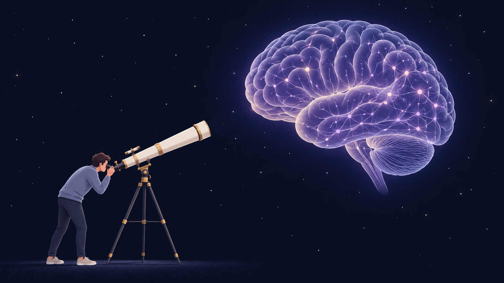
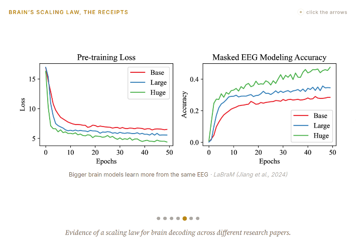
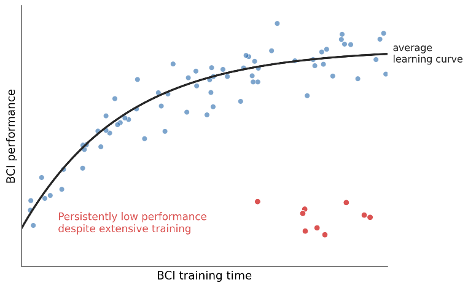
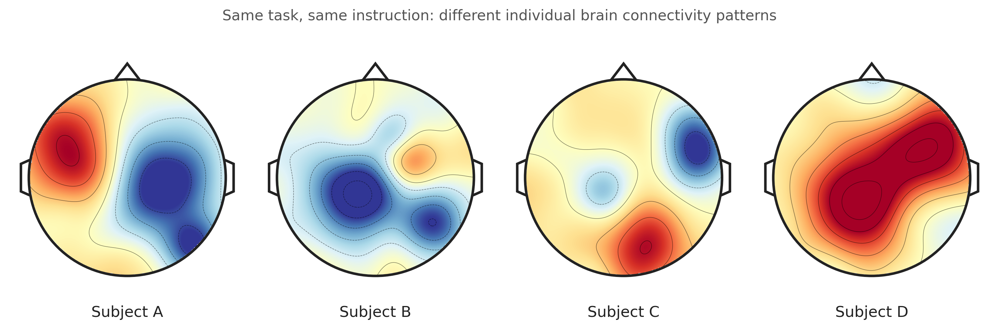

## Why a Good Neural Foundation Model Is Not Necessarily a Good BCI

*Beyond decoding performance: human learning, controllability, and neural diversity*

### 1. The Difference Between Artificial Intelligence and the Human Brain

Both AI and humans can exhibit intelligence. Both can also exhibit forms of agency, although what we mean by agency may be fundamentally different. These two properties reflect how we use AI:

1. We use it to maximize our performance (intelligence, agency).
	- This includes delegating our work, solving complex math problems.
2. We use it to understand ourselves (as a probe).
	- This includes asking AI about my weakness, strength, or to refine our thoughts.

I do not think intelligence is only about modeling and predicting the environment, solving complex problems, or making decisions efficiently. Human intelligence is also about curiosity. We want to understand the truth, explore what we do not know, and sometimes ask questions without knowing whether a useful answer will ever exist. *The pursuit of first principles is necessitated by the very nature of reason itself. - Kant*

What about agency? What do human agency and AI agency have in common? One difference is that humans act because we *want* to, not merely because we *can*. We write, make art, listen to music, and explore the world not simply to maximize performance. Sometimes we do these things to better understand, or to “probe,” ourselves.

Importantly, humans do not use their brains only to understand the environment. Through interacting with the world, we also learn to control and reorganize our own neural activity. This is why I think BCI should not simply become another efficient interface between humans and machines. **BCI offers an opportunity not only to read the brain, but also to help the brain learn.**

  
   
  <em></em>

### 2. BCI as an Agent; BCI as a Causal Probe

**Perspective 1: BCI as an Agent**

Today, we increasingly think of AI as an agent: a system to which we can delegate our work. From this perspective, BCI could become an interface that lets us interact with machines at the speed of thought, reducing the cognitive and physical effort required to communicate our intentions. For individuals with impaired motor or peripheral nervous pathways, agent's role could be especially important to control prosthetics limbs. In other words, BCI agent do the work **for you.** 

**Perspective 2: BCI as a Probe**

But there is another perspective I value more: BCI agent is not only a thing that does my work, but also a causal probe that helps me understand how I think and learn.

We already use external tools to better understand our internal world. Why do we write? Why do we draw? Why do we play music? These activities serve many purposes, but one important aspect is that they allow us to manifest something internal to external. Through this externalization, maybe we can look our writings or musical notes again, organize it, question it, and discover something we had not realized before.

BCI could make a new form of this kind of interaction possible with more finer granularity. Instead of expressing our internal states only through muscles, speech, or movement, we could create a more direct mapping between recorded neural activity and an external device. We could observe certain aspects of our own neural modulation through visual, auditory, or other forms of feedback (e.g., closed-loop stimulation). Conversely, through that feedback, we might learn to modulate neural activity that was initially difficult to control through **voluntary effort alone**.

This is where BCI becomes especially interesting to me. It is not simply as a decoder, but as a closed-loop tool for investigating and shaping volitional neural control.

It is just a start that we can deliberately manipulate the neural-to-action mapping or introduce controlled perturbations, and then observe how behavior and neural activity respond casually. This lets us ask not only what information is represented in the brain, but also what neural activity carries value that a person can learn to generate.

### 3. Why a Neural Foundation Model Is Not the Ultimate Solution

I recently read [*Phase Lock*](https://phaselock.satpugnet.com/) on X (Twitter), which gain attention providing a compelling argument that BCI may be approaching an inflection point similar to where AI was a decade ago. Perhaps we are now in the GPT-2 era.

  
   
  <em>Figure from the Phase Lock blog post of scaling law</em>

I agree with much of this. I have long believed that BCI could become one of the most important technologies for humanity, not only to understand ourselves, but also to expand our abilities and explore the cosmos. And I am very excited about the progress in neural foundation models.

**However, I think this perspective places my overpromise in the idea that scaling neural foundation models will naturally solve many of the fundamental challenges in BCI, as scaling has transformed AI.**

The brain is not simply a source of data to be decoded like what LLM does to text and speech. It is a living, adaptive system that learns and reorganizes itself through the very feedback we provide.

We should not naively assume that the same empirical scaling laws observed in modern AI will necessarily transfer to every aspect of BCI. More recording channels, larger datasets, and more powerful models may substantially improve neural decoding...

- But will they necessarily improve human learning?
- Will they tell us which neural activities can be voluntarily controlled?
- Will they explain why some people acquire BCI skills while others struggle?
- Will they help us understand how neural networks reorganize as people learn?

**These are fundamentally different scientific questions.**

I am not arguing against scaling. I have worked on many BCI projects, and I understand how important decoding performance and the amount of information transfer are. But I do not think we should only measure the benefits of BCI only by bits per second, the number of recorded data, or decoder accuracy.

We should also ask what the user is learning, what neural changes the system encourages, and whether those changes are beneficial and sustainable. Especially, as BCI moves from laboratory to everyday systems intended for long-term human use.

The reason I love neurotechnology community is because I hope it to continually preserves its most beautiful characteristics; People from neuroscience, mathematics, robotics, engineering, neurology, lawmakers are working toward a shared mission; not simply a competition for performance and efficiency like current moment of AI, nor an ad-hoc afterthought of rapid deployment.

> **A BCI company should be able to explain not only why its system works so well, but also why it fails for some people.**

### 4. BCI illiteracy: The People We Should Pay More Attention To

One of the most challenging parts of clinical BCI is that *not everyone* can gain control and benefit from modulating neural signals. This is called **BCI illiteracy.**

  
   
  <em>Conceptual BCI learning curves. Highlight users with persistently low performance despite extensive training.</em>

Some people start with high performance. Others improve gradually as they gain experience. But what interests me most is the group of people in the lower-right corner.

**The people who have spent a long time trying to use a BCI, but still cannot gain reliable control.**

Who are these people? Why are they struggling?
- Is it because the decoder cannot capture the information they are generating?
- Is it because their neural activity has low signal-to-noise ratio? 
- Are they not capable to learn because of relevant neural pathways are constrained by lesions, anatomy, or existing network dynamics?
- Or is it because the feedback system has never given them an opportunity to discover and reinforce an effective neural control strategy?

We do not yet have a complete answer. And this is exactly why I think these users deserve more scientific attention.

Unlike learning to use a conventional AI tool, acquiring a BCI skill may involve learning to modulate neural activity that a person cannot directly observe or consciously manipulate.
When the system fails, the user may not even know what went wrong. There may be no clear strategy they can simply decide to use. It could be a limitation of the brain, a limitation of the decoder, a limitation of the feedback design, or a mismatch between all three.

**We should not assume that the person who performs poorly is the person who cannot learn. Perhaps the BCI has not yet learned how to teach them.**

For me, the goal is not simply to create systems that work exceptionally well for a subset of users.

It is to understand why the system works differently across individuals, and how we can make BCI learning accessible to benefit all.

### 5. A Good Decoder Is Not Necessarily a Good BCI for learning

Here is the central technical concern I have about neural foundation models.

A good decoder is an automatic feature selector trained to extract information that predicts a target variable or task. But **the neural feature that is most useful for decoding performance may not be the feature that is most important for subject learning and plasticity.** A fact that it is loud not necessarily mean it is an important one. A highly discriminative feature is not necessarily voluntarily controllable. 

Consider two neural features.

**Feature A** already provides strong discriminative information about a user's motor intention (predicting speed, positions..etc.)

**Feature B** has weak modulation and contributes little to current decoding accuracy. Thus, the decoder may discard this feature.

If we train a model only to maximize immediate decoding performance, it will rely primarily on Feature A. That is a perfectly reasonable solution for the decoding objective. But what if Feature B is the activity the user could gradually learn to modulate through closed-loop feedback? What if this weak signal is part of a neural pathway that becomes more reliable with training and plays an important role in neural dynamics and learning?

I am not claiming that weak neural signals are always important. But my point is that **current discriminable feature from good decoder alone cannot tell us which weak features are potentially useful and learnable in future.** This is why decoder must incorporate the trajectories of human learning. And if the decoder does not provide feedback that is sensitive to those features, the user may never get an opportunity to learn to control them.

This creates an interesting problem for foundation models. The model may become better at reading the user, while the user does not become better at controlling the activity being read. In short: if the AI does well, your brain learns less.

**This leads to a trade-off in decoder adaptation.** If a decoder is too rigid, it cannot accommodate emerging control strategies or changing recordings. If it changes too quickly, the user cannot learn a consistent relationship between neural activity and feedback. So perhaps the goal is not simply the most accurate decoder, but one that is **stable enough for a human to learn, yet flexible enough to support new neural control strategies.**

### 6. A Good Representation Does Not Necessarily Explain Neural Dynamics

Another concern is that an accurate neural representation is not necessarily a mechanistic model of the underlying neural dynamics. More non-linear, high-dimensional neural representation that performs well is not necessarily a good representation to explain such dynamics.

A common neural decoding framework can be written as

$$ 
z_t=\mathrm{Encoder}_{\phi}(x_{\leq t}),\qquad  
\hat y_t=\mathrm{Decoder}_{\theta}(z_t)  
$$ 

where ($x_t$) is recorded neural activity, ($z_t$) is a learned representation, and ($\hat y_t$) is the predicted behavior or task variable.

The objective may be to minimize

$$ 
\mathcal L_{\mathrm{decode}}=\mathbb E_t[\ell(y_t,\hat y_t)].  
$$ 

This is a useful framework. It can be highly effective at extracting information relevant to behavior.

But it does not require the model to identify how neural states evolve or how they respond to interventions. A simple dynamical model might be written as (or more generally, $\dot x=f(x,u)$):

$$ 
x_{t+1}=Ax_t+Bu_t+\epsilon_t  
$$ 

where ($A$) describes autonomous state evolution and ($B$) describes how an input ($u_t$) affects the system.

Two neural states may be similarly informative about the current behavior but respond very differently to an input. And two models may achieve similar decoding accuracy while predicting different responses to stimulation or feedback perturbations. A model trained only on observational decoding data may not be able to distinguish these possibilities.

This is particularly important for closed-loop stimulation, rehabilitation, and adaptive BCI.

We want to know not only what a neural state represents, but also: 
- How does the representation evolve across time? 
- What changes if we stimulate? 
- Which states can the system reach? 
- Which transitions can become easier through learning? 
- And how does all of this depend on context and the user’s current state?

Foundation models may provide scalable representations from large and heterogeneous recordings.

But **learning a useful latent representation is not the same as identifying the causal dynamics of a neural system.**

To develop reliable control, we may need to combine representation learning with system identification, experimental perturbations, and careful analysis of how neural dynamics change over time.

### 7. Will Neural Foundation Models Preserve Our Neurodiversity?

I sometimes notice that people increasingly talk like GPT, using similar expressions and organizing their thoughts in similar ways.

As I grew up in Korea, I also noticed how people often made similar jokes in similar situations. When I came to the US, one of my favorite parts was meeting people who think differently, choose differently, and approach the same situation from different perspectives.

I value this cognitive diversity.

And this makes me wonder about something even more fundamental when it comes to BCI.

**If a foundation model becomes a shared teacher for feedback, the representation it shares could force every brain to converge toward one standard geometry.**

Consider [Meta’s TRIBE v2,](https://ai.meta.com/blog/tribe-v2-brain-predictive-foundation-model/) a foundation model that predicts cortical responses to visual, auditory, and linguistic stimuli across hundreds of subjects. I think this is exciting work. The ability to learn shared representations across people could fundamentally change how we study the human brain.

But imagine using a population-level neural representation as a reference for neurofeedback (choosing what is the right answer to give to the subject, based on the averaged answer). What if the feedback system rewards users for producing neural activity that resembles an average or highly discriminative representation learned from other people?

The brain learns through the very feedback we provide. So my neural representation is no longer just being measured. It is being taught, and pulled toward the model’s standard geometry, just like everyone else’s.

The model may be very good at predicting a common neural response, but **why should that common response necessarily be the best neural subspace for each individual to learn to control?**

  
   
  <em></em>

Everyone have different brain anatomy, neural dynamics, and network connectivity. Even if they achieve the same BCI performance, they may get there through entirely different neural strategies.

I am not claiming that a shared representation necessarily imposes a shared learning target. It depends on how we design the feedback. But once a foundation model becomes the teacher in a closed-loop system, it is no longer merely observing the brain. **The model may begin to shape what the brain learns.**

This is where I think we need to be particularly careful.

The neural features that are most common across subjects, most discriminative for a task, or most useful for transfer learning are not necessarily the features that an individual can most effectively learn to modulate.

A weak and highly individual neural feature may be overlooked by a population-trained model. Yet that feature might become important for developing a new control strategy through appropriate feedback.

Conversely, a shared neural representation may provide effective control for some users while making learning more difficult for others whose intrinsic neural dynamics follow different directions.

This raises a question that I think deserves much more attention:

**Are we building BCIs that adapt to how different brains learn, or are we asking different brains to adapt to what our models have learned?**

I believe neural foundation models could help us understand individual differences, rather than erase them.

It means allowing different people to discover and develop their own neural control strategies, rather than assuming that one shared representation or learning pathway is optimal for everyone.

> **A good BCI should not make every brain learn in the same way. It should help each brain learn in the way that works best for it.**

### 8. Toward a More Holistic View of BCI

Neural foundation models may help us decode increasingly complex neural signals, improve transfer across individuals, reduce calibration requirements, and build more useful brain-machine interfaces.

But they should be one component of a larger scientific framework.

A truly useful BCI should not only decode what a person can already express.

It should also help us understand what neural activity a person can learn to control, what limits that learning, and how those limits might change through appropriate feedback and intervention.

This suggests that we should evaluate BCI systems across several dimensions:

- **Decodability:** What can we read from the neural signal?
- **Controllability:** What can the user intentionally modulate?
- **Learnability:** What new control can the user acquire through feedback?
- **Dynamics:** How do the neural states evolve and respond to interventions?
- **Generalizability:** How do these mechanisms vary across users?
- **Safety and agency:** Does the system preserve user intention?
    

Fundamental, what makes a BCI unique is because it requires different priorities than AI.

**A good BCI should not be a best decoder, It should support the user to understand and control themselves better.**

And perhaps the signals that seem least useful to our decoder today will teach us something important about what the brain may be capable of learning tomorrow.